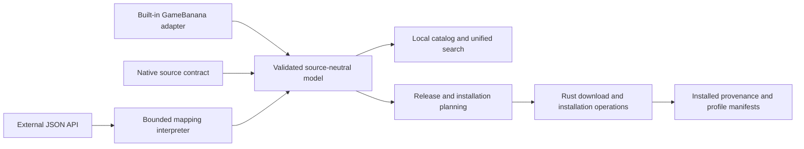

# RFC 002: User-added mod sources

**Status:** Work in progress; not an implemented protocol
**Created:** 2026-10-29
**Proposed protocol:** `dmm-source` 1.0

## Summary

Users can add public mod sources by URL, browse them together, and download,
install, update, and manage their mods through DMM. Sources can serve a native,
versioned JSON contract or use an imported declarative mapping for an existing
JSON API. Both produce the same internal model. GameBanana becomes a built-in
adapter to that model while retaining its existing behavior.

DMM knows the shape of the data through schemas shipped with the application,
an explicit protocol version, and declared capabilities. A source descriptor
selects supported behavior; it cannot redefine the meaning of contract fields.
A mapping translates an external API into that contract and must pass the same
validation. JSON shape alone does not establish update or installation semantics.

This RFC records the product decisions from the design interview and proposes
concrete wire shapes. Names, limits, and examples below are reviewable proposals.
Publishing schemas and a conformance validator is implementation work, not
something this document claims has already happened.

## Scope and decisions

- Any compatible source URL can be added with user consent. No registry or DMM
  server registration is required.
- Desktop requests sources directly and caches locally. Static JSON hosting and
  dynamic APIs are supported. Initial access is public only, without tokens,
  account login, cookies, or OAuth.
- Native sources use a standard contract. Existing APIs can use shareable,
  versioned mapping files with bounded operations. No downloaded adapter code,
  HTML scraping, or visual mapping editor is required initially.
- Core installation functionality is required; rich metadata and social reads
  are optional capabilities. No comment posting, voting, or account actions.
- Unified search, source filters, explicit equivalence links, same-source
  dependency resolution, profile sharing, and one-click integration are part of
  the full target, delivered in stages.
- Hashes are optional for every source. Supported supplied hashes are verified;
  a mismatch prevents installation. No hash means no publisher-hash verification.
- Existing supported package formats and installation operations remain the
  boundary. A source cannot provide install scripts or arbitrary destinations.

## Current implementation and migration pressure

These are current implementation anchors, not proposed external API shapes:

| Concern                                   | Current implementation                                                                                                   | Consequence                                                                     |
| ----------------------------------------- | ------------------------------------------------------------------------------------------------------------------------ | ------------------------------------------------------------------------------- |
| Desktop discovery, detail, files, updates | `apps/desktop/src/lib/gamebanana-catalog.ts`, Rust `providers/gamebanana/catalog/`                                       | Preserve direct access and local caching; a central API proxy is unnecessary.   |
| Identity                                  | `packages/shared/src/providers/game-banana.ts`, desktop `lib/mods/submission-ref.ts`, Rust `providers/submission_ref.rs` | Numeric IDs and `snd-`/`wip-` slugs cannot identify arbitrary source instances. |
| Catalog DTO                               | `packages/shared/src/dto/mod.dto.ts` derives from the database schema                                                    | Introduce a source-neutral contract independent of central database records.    |
| Local state                               | `apps/desktop/src/types/mods.ts` extends `ModDto`                                                                        | Separate listing metadata from installed release and artifact provenance.       |
| Download reference                        | `gamebanana-file://<submission>/<fileId>` in `gamebanana-catalog.ts`                                                     | Preserve stable artifact references; resolve transport URLs at download time.   |
| Variants                                  | `lib/mods/mod-variants.ts`, `ModFileTree`, `selectedDownloads`                                                           | An archive choice differs from a choice of VPKs inside it.                      |
| Updates                                   | `lib/mods/mod-updates.ts`, `BatchUpdateResult.selectionRequired`                                                         | Preserve unresolved selections without replacing the installed mod.             |
| One-click                                 | `hooks/use-deep-link.ts`                                                                                                 | Current validated GameBanana links need a compatible path alongside new links.  |
| Profiles                                  | `ProfileImportMod` in `types/mods.ts`                                                                                    | Carry source and release references instead of relying on saved URLs.           |

See the [domain model](../../apps/docs/content/docs/developer-docs/domain-model.mdx),
[architecture](../../apps/docs/content/docs/developer-docs/architecture.mdx),
[packaging RFC](../000-mod-packaging/proposal.md), and
[interchange RFC](../001-mod-interchange/proposal.md). This proposal does not
replace package formats or silently change the interchange format.

## Architecture and ownership



Rust owns source networking, validation at the remote boundary, mapping
execution, local catalogs, and file operations. The frontend presents capability
aware UI through generated IPC types and existing React Query patterns. Shared
contracts must not depend on application or database internals. Rust exported
types continue to use the project's generated bindings workflow.

DMM infrastructure is not required for custom sources. GameBanana-specific
moderation, overrides, author enrichment, mirrors, and recognition services remain
explicit adapter integrations, not services implicitly promised to every source.

## Identity

Every reference has three distinct levels:

1. **Source instance:** a locally registered source with an accepted origin,
   provider-declared source ID, descriptor location, and adapter configuration.
2. **Listing:** source instance plus opaque listing ID. IDs are strings, case
   sensitive, and never parsed as globally meaningful numbers.
3. **Release and artifact:** listing plus release ID, content revision, and
   artifact ID. Component and choice IDs are stable within a listing.

Sources must not reuse an ID for an unrelated entity. The GameBanana adapter
namespaces submission kinds inside its listing IDs, preserving mod/sound/WIP
distinctions. Authors and favorites are source-scoped as well.

A local source key is not a portable identity. Exports include the accepted
origin, declared source ID, descriptor URL, and mapping identity/version when
applicable. Import resolves those to a local key after consent. Multiple catalogs
on one origin remain distinct through their declared IDs. A descriptor URL is a
locator, not proof of ownership.

Changing the source origin requires explicit migration confirmation. Neither a
matching declared ID nor an HTTP redirect silently transfers trust. Accepted
migrations retain existing local references and record the previous origin.
Existing installations survive disabling, removal, and outages; their provenance
is retained so re-adding the accepted source can reconnect them.

## Discovery and the native descriptor

The normal input is a descriptor URL. A website root may optionally discover it
at `/.well-known/dmm-source.json`. Discovery never silently enrolls a source.
Relative document URLs resolve against the containing document. Template
parameters are encoded as individual path/query values, never raw URL fragments.

Example dynamic descriptor:

```json
{
  "format": "dmm-source",
  "protocolVersion": "1.0",
  "sourceId": "example-community",
  "name": "Example Community Mods",
  "homepageUrl": "https://mods.example.org/",
  "gameId": "deadlock",
  "catalog": {
    "kind": "api",
    "listUrl": "./v1/mods",
    "detailUrlTemplate": "./v1/mods/{listingId}",
    "releaseUrlTemplate": "./v1/mods/{listingId}/releases/{releaseId}"
  },
  "capabilities": {
    "search": "server",
    "releaseHistory": true,
    "installationChoices": true,
    "dependencies": true,
    "comments": false,
    "changelog": false
  },
  "networkOrigins": {
    "api": ["https://mods.example.org"],
    "downloads": ["https://cdn.example.org"],
    "media": ["https://cdn.example.org"]
  }
}
```

Static sources replace `catalog` with:

```json
{
  "kind": "static",
  "indexUrl": "./catalog.json"
}
```

A static index contains `items`, each a listing summary with a `detailUrl`, and
an optional `nextUrl` for another immutable page of the same snapshot. Each page
includes the same `snapshotId`. Static detail documents embed current release
data or link to release documents. No endpoint templating or server search is
needed. DMM indexes a complete snapshot locally; interrupted refreshes do not
replace a previous complete snapshot or imply deletion.

The native API list accepts `q`, repeated `hero` and `contentType` parameters,
`cursor`, and `limit`. Response shape is `{ items, nextCursor, total? }`.
`nextCursor: null` means complete. `total` is optional, never fabricated.
An empty page with a continuation is not end-of-catalog. Cursors are opaque and
bound to the query; a changed query discards them. Supported filters and sort
orders must be declared in the descriptor before DMM sends them.

Optional operations such as comments, changelog, author lookup, release history,
and batch update lookup require corresponding declared operation URLs. They use
the same pagination envelope where applicable. A capability without its required
operation or embedded data is a validation error, not an invitation to guess an
endpoint. The published schema must encode these conditional requirements.

## Required information and optional capabilities

| Entity                     | Required core                                                                                                | Optional information                                                                                                             |
| -------------------------- | ------------------------------------------------------------------------------------------------------------ | -------------------------------------------------------------------------------------------------------------------------------- |
| Source                     | Format/version, source ID, display name, game, catalog location, network origins                             | Icon, homepage, capabilities, supported filters                                                                                  |
| Listing                    | Stable ID, title, availability, detail reference or full detail                                              | Description, authors/credits, categories, heroes, tags, images/audio, dates, content warnings, counts, donations, external links |
| Installable listing detail | Listing identity, current release reference or embedded release                                              | History, changelog, comments, suggested equivalents                                                                              |
| Native release             | Stable release ID, content revision, artifacts, installation mode                                            | Display version, published date, explicit choices, dependencies, compatibility notes                                             |
| Artifact                   | Stable ID, filename, package format, direct URL or resolver reference                                        | Byte size, hashes, archived status, description, expiry metadata                                                                 |
| Installed record           | Source/listing/release provenance, selected artifacts/components, actual installed files, profile membership | Cached metadata, version hold, skipped revision, verification evidence                                                           |

Availability is `available`, `unavailable`, or `removed`; an unavailable listing
may lack a current installable release. A failed request does not establish
removal. Optional values remain absent when unknown: unknown download counts are
not zero, unknown content warnings are not an assertion of safe content, and an
unknown update state is not "up to date."

Descriptions carry a declared format: plain text, Markdown, or sanitized HTML.
All remote rich content is sanitized; scripts and executable embeds are not
rendered. Media URLs obey the accepted network origins. Counts include their
meaning, and ratings include their scale; they are not comparable across sources.

DMM publishes stable hero and content-type identifiers. Native sources use them;
mappings translate provider values with lookup tables. Unrecognized categories
remain source tags. Unknown values fail a positive filter rather than being
invented. DMM shows when a source cannot satisfy a requested filter. Hiding adult
content conservatively excludes records with unknown classification.

## Releases, artifacts, and installation choices

A release identifies a published version. Its content revision changes whenever
installable bytes, component membership, dependency requirements, or installation
instructions change. A display version may remain the same. Description edits do
not change the content revision. Native sources must honor this invariant even
though optional hashes limit DMM's ability to detect violations.

A release document can describe multiple downloadable archives and components
inside them. An artifact is a transport unit; a component is an installable unit.
A required component may contain several VPKs. Choice groups select components,
not guessed filename patterns.

```json
{
  "id": "release-17",
  "contentRevision": "revision-2",
  "version": "1.4.0",
  "versionScheme": "semver",
  "artifacts": [
    {
      "id": "skins",
      "filename": "skins.zip",
      "format": "zip",
      "download": { "url": "https://cdn.example.org/skins-r17-2.zip" }
    },
    {
      "id": "audio",
      "filename": "sound.vpk",
      "format": "vpk",
      "download": { "url": "https://cdn.example.org/sound-r17-2.vpk" }
    }
  ],
  "installation": {
    "mode": "components",
    "components": [
      {
        "id": "base",
        "label": "Required assets",
        "files": [
          { "artifactId": "skins", "path": "base/models.vpk" },
          { "artifactId": "skins", "path": "base/materials.vpk" }
        ]
      },
      {
        "id": "red",
        "label": "Red skin",
        "files": [{ "artifactId": "skins", "path": "red/skin.vpk" }]
      },
      {
        "id": "blue",
        "label": "Blue skin",
        "files": [{ "artifactId": "skins", "path": "blue/skin.vpk" }]
      },
      {
        "id": "sound",
        "label": "Optional sound",
        "files": [{ "artifactId": "audio", "path": "sound.vpk" }]
      }
    ],
    "requiredComponents": ["base"],
    "choiceGroups": [
      {
        "id": "color",
        "label": "Skin color",
        "minSelections": 1,
        "maxSelections": 1,
        "componentIds": ["red", "blue"],
        "defaultComponentIds": ["red"]
      },
      {
        "id": "extras",
        "label": "Extras",
        "minSelections": 0,
        "maxSelections": 1,
        "componentIds": ["sound"],
        "defaultComponentIds": []
      }
    ]
  }
}
```

Paths are exact, normalized, archive-relative names with forward slashes, never
game destination paths. For a standalone VPK the path is its declared filename.
Missing files, traversal, ambiguous duplicate entries, unsupported formats, or
invalid component references reject the installation plan. Source metadata never
bypasses Rust archive validation or existing package handling.

Every component belongs either to the required set or one choice group in v1.
Each group's bounds must be satisfiable and its defaults valid. Arbitrary
conditional expressions between groups are outside this version. Shared file
references are deduplicated; actual VPK conflicts still use DMM's conflict logic.
Package-native choices must be interpreted by the existing package handler, not
overridden by a contradictory source manifest; contradictions stop installation.

Sources without this metadata declare `installation.mode: "manual"`. DMM shows
archives and extracted VPKs for user selection. This preserves legacy behavior
without asserting that every file is required or mutually exclusive.

### Downloads and integrity

Persist artifact identity and provenance, not a temporary CDN URL. An artifact
has exactly one of a direct download URL or a resolver URL returning
`{ url, expiresAt? }`. Resolve shortly before download; expired links can be
resolved again within a bounded retry policy. Resolved URLs cannot change the
requested artifact or release revision. Resumption requires compatible server
validators; otherwise restart the staged download.

Optional `size` is a nonnegative integer byte count; absent differs from zero.
Optional `hashes` names supported algorithms. SHA-256 is preferred; legacy MD5
can detect accidental corruption but is not a strong authenticity guarantee.
DMM verifies all supplied supported hashes before installation. Unknown
algorithms do not produce a verified badge. A mismatch is an integrity error,
not permission to retry from a linked equivalent listing.

### Updates, holds, and rollback

Native update detection compares the installed `(releaseId, contentRevision)`
with the source's explicitly designated current release. IDs need not sort.
Mapped adapters declare an update signal and its strength: content revision,
artifact fingerprint, file timestamp, or unavailable. Metadata timestamps are
not silently substituted for file updates. A weaker signal may only establish
that content could have changed; the UI must not promise exact reproducibility.

The normalized model distinguishes native release provenance from an adapter's
observed snapshot. When an upstream API has no release IDs, a mapping may create
a deterministic observation key from its declared signal, but must label it as
such. That key is not a historical release the server can necessarily retrieve.
Without a usable signal, keep local installation provenance and declare update
detection unavailable; do not manufacture a native content revision.

Selections persist by stable group/component IDs. A missing selected component,
new group requiring a decision, or newly required component pauses the update
for confirmation. Defaults apply to first installation, not as silent replacement
choices during an update. Manual selections can be carried forward only when
unambiguous; filename heuristics cannot establish stable semantic equivalence.

A local version hold prevents automatic update selection and dependency-driven
replacement. A skipped revision suppresses that candidate, not future releases.
Release history is optional. Holding an installed version does not guarantee
that its bytes remain downloadable. Exact historical requests must fail visibly
when unavailable, never silently resolve to latest.

Downloads, extraction, and plan validation happen before replacing installed
files. Failed or unresolved updates preserve the installed version. Rollback
depends on a retained local backup or a still-downloadable historical revision;
source history alone is not a rollback guarantee.

## Dependencies

Required same-source dependencies are machine-readable and resolved recursively.
Recommended dependencies are offered separately. Cross-source dependencies are
displayed as links for manual resolution; equivalence links do not authorize
cross-source dependency substitution.

Exact constraints identify release ID and, when exact bytes matter, content
revision. Version ranges are allowed only with an explicitly supported version
scheme, initially SemVer. Opaque IDs and dates are not interpreted as SemVer.
For example:

```json
{
  "listingId": "shared-assets",
  "requirement": "required",
  "constraint": {
    "kind": "exact",
    "releaseId": "assets-4",
    "contentRevision": "1"
  }
}
```

Range constraints use `{ kind: "range", scheme: "semver", value: "^2.0.0" }`.
A source must expose enough release metadata to resolve a range; the resolver
does not assume unavailable history exists. Constraints are solved for the
target profile, including already installed dependents and holds. Unsatisfiable
constraints, dependency cycles, or required choices needing input stop the plan
with an explanation. Never silently upgrade a shared dependency.

Show the complete plan, download sizes where known, replacements, and selections
before applying dependency changes. Track which mods require a dependency;
uninstalling one dependent must not remove files needed by another. Prevent or
explicitly resolve removal of a still-required dependency. A failed multi-mod
operation must report partial results and restore affected prior installations
where rollback is available; it must not claim success for an incomplete plan.

## Declarative mappings

A mapping is a versioned document imported by the user and associated with a
source. It declares its own mapping format version, adapter ID and revision,
supported DMM contract version, network origins, operations, and field transforms.
Technical users or source operators author it; ordinary users import it.

The interpreter permits JSON extraction, constants, explicit fallback values,
lookup tables, basic scalar conversions, encoded URL templates, and bounded
request chaining. Pagination supports cursor, page-number, offset, and next-URL
styles. Static index pages also obey the same network and resource limits.
No arbitrary expressions, JavaScript, shell execution, recursive programs,
filesystem reads, HTML scraping, or access to application credentials.

Illustrative list operation for an external API:

```json
{
  "format": "dmm-source-mapping",
  "mappingVersion": "1.0",
  "adapterId": "example-api",
  "revision": "3",
  "targetProtocolVersion": "1.0",
  "operations": {
    "list": {
      "request": {
        "method": "GET",
        "url": "https://api.example.org/mods",
        "query": { "page": { "input": "page" } }
      },
      "itemsPointer": "/results",
      "pagination": {
        "kind": "page",
        "firstPage": 1,
        "hasMorePointer": "/has_more"
      },
      "fields": {
        "id": { "pointer": "/id", "convert": "string" },
        "title": { "pointer": "/name" },
        "availability": { "constant": "available" },
        "detailUrl": {
          "template": "https://api.example.org/mods/{id}",
          "parameters": { "id": { "pointer": "/id" } }
        }
      }
    }
  }
}
```

This is an operation excerpt, not a complete importable adapter. A complete
adapter also needs its source descriptor, detail/release/artifact operations, and
declared update semantics. JSON Pointer extraction is relative to each item for
field transforms and to the response root for pagination. Missing required
values fail normalization; optional absent fields remain absent.

Chaining binds named outputs of earlier requests in an acyclic operation graph.
Every operation and transform is schema-validated before execution. Suggested
client-enforced starting limits are four chained requests per detail operation,
four concurrent requests per source, 100 pages per refresh job, 10 MiB per JSON
response, and a 30-second request timeout. Limits are implementation tuning
values, not a source's authority to raise its own budget. Larger static catalogs
can resume in later bounded jobs; incomplete snapshots remain explicitly partial.
Artifact and extraction limits use the existing installer policy separately.

Repeated cursors, repeated next URLs, missing termination signals, and budgets
exhausted produce an incomplete-operation result. Malformed records can be
isolated with diagnostics; partial data must never be used to infer deletion.

Mapping updates are offered, not automatically applied. Show changed origins and
capabilities, validate against fixtures, retain the previous revision, and require
acceptance before activation. Changing identity derivation requires an explicit
migration; updating a field expression must not silently orphan installed mods.
Retain the accepted mapping revision and digest in provenance.

## Unified search and equivalent listings

DMM searches enabled sources concurrently and renders results progressively.
Use stable source order and round-robin batches of each source's ranking. Append
late results without reshuffling already displayed rows; pagination tracks each
source independently. Mark loading, stale, incomplete, unsupported-filter, and
failed sources separately. One failed source does not erase other results.

Static sources search their local index. Dynamic sources use declared server
search, or local search over a declared complete catalog. If only partial data is
available, label the search incomplete. Never claim a global total or comparable
relevance score from unrelated provider scores. Source-specific sorting may be
available; global download-count ranking is not promised.

Users may link equivalent listings. Their accepted links group alternatives and
travel in exported profiles. Provider suggestions require confirmation. Links
are user assertions, not proof of identical artifacts or release correspondence.
Grouping preserves visible source identities and does not fabricate aggregate
ratings or download counts.

One selected source owns each installed mod's update provenance. Switching to an
equivalent listing requires explicit selection of its release and variants, with
a replacement plan. Never automatically choose the newest equivalent or use it
as a download fallback. Failure leaves the original installation intact.

## One-click and profile integration

Add a versioned install-link payload containing a source descriptor URL, declared
source ID, listing ID, optional exact release/revision, and optional choice IDs.
Mapped sources may additionally reference a mapping URL and digest. The concrete
URI spelling must fit DMM's registered schemes during implementation; existing
GameBanana links retain their current parser and behavior.

The new flow is:

1. Parse the bounded payload and validate URLs before fetching anything.
2. Resolve the source descriptor. Unknown sources require consent showing the
   origin, adapter, and requested mod; imported mappings are included in review.
3. Resolve the listing and requested release. A missing pinned release is an
   error, not permission to select latest.
4. Validate choices, dependencies, origins, and supported formats. Ask for any
   missing decisions. Capture the target profile for the operation.
5. Pass the accepted plan to existing download/install operations. Deduplicate
   repeated link deliveries by target profile and requested installation.

Links cannot embed install scripts, arbitrary file destinations, or a raw
download URL that bypasses source resolution. A one-click link never silently
enrolls or re-enables a source.

Profile exports carry source descriptors, accepted mapping references/digests,
listing identities, installed release/revision, holds, artifact references,
choices/manual file selections, ordering, and user-owned equivalence links.
Transient resolved URLs are not the source of truth. Exports contain no secrets.

Import lists missing sources and asks which to add. Users can continue with a
partial import; unresolved mods remain visible with reasons. Do not silently
substitute sources, releases, or variants. Imported equivalence assertions also
require acceptance. Changes to the existing interchange format need explicit
versioning or a documented extension; older imports remain readable.

## Network policy, caching, and failure behavior

Remote sources use HTTPS by default. Local/private-network sources and insecure
HTTP require explicit opt-in. Source descriptors declare API, download, and media
origins; these are reviewed at enrollment. Additional destinations require
approval. Redirects and resolver results obey the same policy, including resolved
IP checks to prevent a public host from silently becoming a private-network
request. Requests do not inherit browser cookies or application authentication.

Honor `ETag`, `Last-Modified`, and `Retry-After` where provided. Bound retries with
backoff and cancellation. Cache per source instance, operation, query, and mapping
revision. Display cached results with freshness information. Failed refreshes do
not invalidate installed provenance or turn missing pages into deletion events.

Explicit tombstones or a complete authoritative snapshot may mark a listing
removed. `404` for one release means that release is unavailable; it does not
delete installed files. Disabling a source stops refreshes and new requests.
Removing it retains installation provenance and offers cache cleanup separately.

Distinguish unsupported protocol/capability, invalid data, unavailable content,
network failure, throttling, integrity failure, and selection required. Present
actionable diagnostics with source and operation context, without logging entire
responses or signed download URLs.

## Compatibility and author tooling

Ship canonical JSON Schemas for descriptors, native records, mapping documents,
and link/profile source references. Use stable schema identifiers and a pinned
JSON Schema dialect, proposed as 2020-12. DMM uses its bundled schemas, not schemas
downloaded from a source at runtime.

Major protocol versions break compatibility and are rejected when unsupported.
Minor versions add optional fields/capabilities. Unknown optional metadata may be
ignored; unknown required installation behavior cannot. Capability declarations
must match the operations and data actually supplied. Installed mods remain
manageable when their source becomes incompatible.

The conformance validator must check both shape and semantics: unique IDs,
referential integrity, valid selections, allowed URLs, pagination termination,
release/update invariants across fixture revisions, and dependency constraints.
Publish a minimal static source, a dynamic-source fixture, and a mapped API fixture
with expected normalized outputs. Generated schemas alone are not a sufficient
compatibility test.

## GameBanana parity checklist

The built-in adapter is the first integration test of the model. Each row needs
an executable fixture or documented manual verification before migration ships.

| Existing behavior                                                                | Required outcome                                                         |
| -------------------------------------------------------------------------------- | ------------------------------------------------------------------------ |
| Mods, sounds, WIPs, stable submission identity                                   | Preserve kind namespaces and old IDs/links.                              |
| Browse/search, pagination, facets, categories, heroes, dates, sorting, favorites | Preserve GameBanana behavior and normalize shared filters.               |
| Author lookup and profiles                                                       | Preserve provider identity and existing enrichment.                      |
| Descriptions, credits, images/thumbnails, audio, tags, maps, donation links      | Retain supported metadata without making it mandatory for other sources. |
| NSFW, obsolete state, moderation policy and overrides                            | Preserve GameBanana rules; label their source and scope.                 |
| Likes, download counts, comments, changelog                                      | Preserve read-only presentation and pagination.                          |
| Multiple archives, archived files, metadata, file order, checksums               | Preserve selection, display, ordering, and download behavior.            |
| Stable file handles, direct resolution, mirrors where currently used             | Keep GameBanana transport logic behind its adapter.                      |
| Multi-VPK archives, manual choices, package-specific handling                    | Preserve installed files, manifest order, and conflict handling.         |
| Update detection, skipped updates, ambiguous-selection flow, backups             | Preserve current semantics while adding explicit provenance.             |
| Dependencies and external links                                                  | Normalize available evidence without inventing versions.                 |
| One-click, profiles, imports/exports, local add-on recognition                   | Retain compatibility and source identity throughout.                     |

This inventory is grounded in the current desktop catalog DTOs and flows. Before
implementation, audit remaining GameBanana-specific call sites against this table;
do not treat the table as proof that every service-side feature was already tested.

## Delivery plan and acceptance criteria

### 1. Common model and GameBanana parity

Introduce source-neutral types and adapter boundaries. Migrate existing local
state, deep-merge keys, catalog keys, favorites, profiles, and Rust manifest
references together. Preserve compatibility aliases for old slugs and filenames;
do not rename installed files merely to encode a new identity. Keep central
GameBanana database records separate from the new desktop contract.

Acceptance: existing installed libraries and profile fixtures migrate without
redownload, identity collision, or changed enabled files. The parity checklist
passes. Exported Rust bindings are regenerated rather than hand-edited.

### 2. Native sources

Implement enrollment, descriptors, static/API catalogs, validation, capabilities,
downloads, choices, updates, holds, one-click, and profile provenance. Publish
schemas, minimal examples, and the first conformance tests.

Acceptance: a public static source and a dynamic fixture can install, update,
pause for changed selections, survive an outage, and import into a fresh profile.
Optional metadata and hashes are truly optional. Hash mismatches are rejected.

### 3. Mapped sources

Implement the bounded interpreter, mapping imports and updates, origin review,
diagnostics, and declared update-signal strength.

Acceptance: fixture APIs with different fields, cursor/page pagination, chained
download resolution, and absent release IDs normalize correctly. Cycles, excess
budgets, malformed records, and new origins fail predictably. No source code runs.

### 4. Unified search, equivalence, and dependency resolution

Implement progressive multi-source search, common filters, user-owned equivalent
groups, explicit source switching, and same-source constrained dependency plans.

Acceptance: slow or failed sources do not block usable results; identical IDs from
different sources remain separate; equivalent releases are never silently swapped;
conflicting dependencies and holds prevent unsafe replacements. Profile imports
preserve accepted links and expose unresolved requirements.

These stages describe delivery order, not permission to drop later requirements.
Each can be tested independently; the full RFC target includes all four.

## Review scenarios

- One listing offers two alternative archives; another archive contains two
  required VPKs. DMM must not confuse alternatives with required bundles.
- A release renames a file but retains component identity; selection survives.
  Removing the selected component requires input and leaves installation intact.
- A source edits its description only: no content update. Replacing a native
  artifact requires a new content revision even without hashes.
- Two origins publish listing `42` and declare the same source ID: no collision
  or automatic trust transfer. A confirmed origin migration preserves provenance.
- A signed download URL expires: re-resolve the same artifact, not latest release.
- A profile pins a deleted release: partial import reports it unresolved.
- A mapping changes ID derivation or network origins: explicit acceptance and,
  for identity changes, migration are required.
- A static snapshot fails on page two: retain the previous snapshot and do not
  mark unobserved listings removed.
- Search results arrive in different orders: preserve displayed rows and show
  source status; do not present a fictitious global ranking.
- Two dependents request incompatible shared assets: explain the conflict before
  changing files. An equivalent listing does not resolve it automatically.
- A source disappears: installed mods can still be enabled, disabled, and removed.

## Deferred work

Authenticated sources, OAuth, social writes, a visual mapping editor, arbitrary
adapter code, automatic cross-source dependencies, automatic fallback between
equivalents, a mandatory source registry, custom-source mirroring, and new package
execution mechanisms are outside this proposal. No source has to implement every
optional GameBanana feature to be useful.

**AI assistance:** Drafted with Codex from the maintainer's design interview and
read-only inspection of the current implementation. Requires human review before
implementation or publication as a stable protocol.
