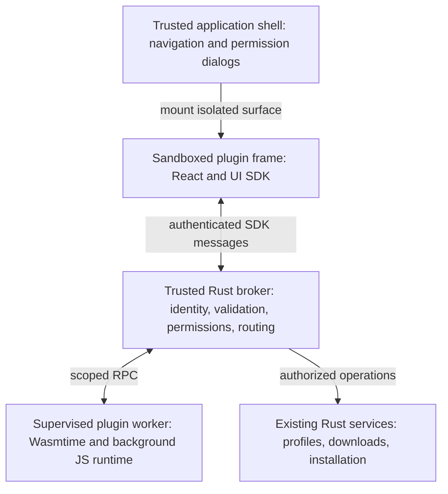

# RFC 003: Sandboxed plugin platform

**Status:** Draft; first slice implemented on Windows (see `packages/plugin-runtime`)
**Created:** 2026-10-30
**Proposed SDK:** `dmm-plugin` 1.0

## Summary

Allow users to install third-party plugins that provide first-class React views,
background TypeScript, and Rust commands. React runs in sandboxed frames embedded
in the app window. Rust compiles to WebAssembly and executes in a supervised
backend worker, outside the frame. All access to privileged application functionality passes through a
Rust-owned permission broker.

Authors ship one package with a manifest, bundled JavaScript, optional Rust/WASM,
assets, and translations. Plugins can be UI-only, backend-only, or both. This RFC
defines the intended boundaries and behavior; SDK names and runtime choices remain
proposals until validated by prototypes.

## Goals and exclusions

- Support ordinary React components, hooks, local state, and bundled dependencies
  from the first release, with pages, settings views, and panels.
- Support typed commands, progress events, cancellation, and background work
  independently of whether a plugin view is open.
- Keep permissions explicit, revocable, and enforced outside plugin code.
- Contain plugin failures and provide reliable disable, update, and recovery flows.
- Keep existing Rust services responsible for installation and local game files.

Arbitrary native libraries, shell execution, direct game-file writes, and loading
third-party code into the main application React tree are outside this proposal.
Installing a plugin does not install a native Tauri plugin. Untrusted Rust cannot
register arbitrary native `#[tauri::command]` functions in the application process.

## Current implementation

The current plugin loader in `apps/desktop/src/lib/plugins.ts` discovers bundled
modules through Vite globs. `apps/desktop/src/plugins/types.ts` exposes React
`Render`, `Settings`, and `Page` components, which execute inside the host frontend.
This is a trusted extension mechanism, not a third-party sandbox.

The main-window permissions in
`apps/desktop/src-tauri/capabilities/default.json` include filesystem, store,
network, and process operations. `apps/desktop/src-tauri/tauri.conf.json` currently
sets CSP to null. External plugin views must not inherit these privileges or this
security configuration. Existing bundled plugins remain trusted during migration;
the external package loader must never fall back to the bundled module loader.

## Runtime architecture



The supervisor manages a worker per active plugin. Rust/WASM runs under Wasmtime
with memory and execution limits. Background TypeScript compiles to JavaScript
and runs in an isolated engine, with QuickJS as an initial candidate. Neither
runtime receives ambient filesystem, network, environment, or process access.
WASI facilities, if used, are explicitly limited; default filesystem or socket
access is not enabled.

A worker process provides crash containment, not an OS security sandbox by
itself. WASM/JS runtime isolation and restricted host bindings are the initial
execution boundary. Platform process restrictions should provide defense in depth;
their availability and residual runtime-escape risks must be documented.

Plugin commands are namespaced exports of these runtimes. A host-owned router
dispatches calls rather than modifying Tauri's native command registry. Execution,
memory, message size, queue depth, event rate, storage, and concurrent host requests
are bounded. Limits apply to both guest execution and asynchronous host work.

## React as a first-class surface

Plugins export React pages, settings views, and panels through SDK-defined entry
points. Authors use normal React and their own bundled dependencies. An SDK UI
package supplies components, theme tokens, localization support, and typed command
hooks. A declarative UI schema is not required.

The app places sandboxed frames into defined contribution points. Each plugin
owns its React tree and CSS within its surface; it cannot import application
internals, access the host DOM, or mount portals into host chrome. Theme and locale
updates cross the bridge as explicit data. View state is local unless persisted
through plugin storage.

Plugin views have opaque origins and no storage shared with the app, restrictive
CSP, host-controlled navigation, and no direct Tauri IPC or app credentials. Executable
code comes from the verified package, not remote scripts. Network traffic,
including asset requests and browser APIs, must not bypass declared permissions.
The asset-serving layer exposes only that plugin's package resources.

The host establishes bridge identity from the mounted view and its lifetime;
messages cannot claim another plugin ID. Validate sender, payload, and request
correlation. Retire bridge sessions when views close or versions change.

The app owns permission prompts and sensitive confirmations, clearly identifies
plugin surfaces, and prevents them from covering trusted confirmation UI. Dialogs,
focus, resizing, clipboard, navigation, and accessibility need explicit SDK or
embedding behavior. Small repeated surfaces such as a frame per mod card are
not promised initially; prefer bounded panels and host-rendered action labels.

### Embedding decision

Plugin views are `<iframe sandbox="allow-scripts">` elements in the app's own
window, not separate native webviews. A prototype compared both:

- **Separate webviews** (a window or a Tauri child webview) need per-view browser
  arguments, proxies and data folders that differ by platform. Child webviews
  are native layers over the page, so app dropdowns, toasts and dialogs render
  beneath them, they cannot animate or scroll with the page, and their bounds
  must be synced over IPC. Each also costs its own browser process group.
- **Sandboxed frames** are part of the page: layering, focus, resizing and
  theming behave like any other element, and the app draws the surrounding
  chrome. Without `allow-same-origin` the frame's origin is opaque. On WebView2
  the frame still receives Tauri's injected script, but Tauri rejects its IPC
  (`Origin: null`), its `postMessage` IPC fallback never reaches the backend, and
  it cannot read the app document, navigate the app or open popups. A probe page
  served exactly like a plugin confirmed each of these in the running app.

The frame talks only to the embedding page through `postMessage`. The page knows
which plugin it embedded and relays calls to the broker; theme and locale cross
the same channel.

Before release, verify isolation and embedding on every supported desktop backend,
including Wry on WebKit and CEF where shipped. A frame shares the app's renderer
and gets no protection from renderer resource exhaustion.
Unsupported configurations must disable external plugins rather than weaken their
isolation. React views are part of the first release, not a later replacement for
schema-driven UI.

## Package and SDK contract

Illustrative package layout:

```text
plugin/
  manifest.json
  ui.js               # bundled from React/TypeScript sources
  background.js       # optional background TypeScript bundle
  backend.wasm        # optional compiled Rust
  assets/
  locales/
```

The manifest declares a namespaced plugin ID, publisher identity, version, SDK
compatibility range, entry points, command contracts, permissions, and contribution
points. Identity is bound to a publisher; a manifest cannot claim an existing
publisher or plugin merely by copying its ID. Package format and SDK versions are
separate from the plugin's own version.

One versioned contract generates TypeScript clients and Rust bindings for command
inputs, outputs, and events. Validate payloads at runtime on both sides of each
trust boundary. Commands have deadlines, cancellation, structured errors, and
bounded progress streams. Cross-plugin calls are not initially supported.

For example, `plugin.commands.analyzeProfile({ profileId })` follows this flow:

1. React calls the generated client through its authenticated bridge.
2. The broker validates and routes the command to that plugin's worker.
3. The Rust/WASM command requests a profile snapshot through the host API.
4. The broker checks the plugin's grant and requested profile scope; existing
   Rust services return the permitted data.
5. The worker analyzes the snapshot and sends typed progress and results through
   the host to React.

WASM executes in step 3's backend worker, never in the UI frame. Closing the view
ends its subscriptions; independently scheduled background jobs can continue.
Cancelling a mutation does not imply rollback: host operations report whether they
were cancelled before commitment or completed, and expose recoverable outcomes.

## Permissions and host services

The broker denies access by default. Both frontend and backend calls use the same
host-established plugin identity and current grants. Permission names below are
illustrative; the implementation must define exact resource scopes.

| Capability            | Intended boundary                                                                      |
| --------------------- | -------------------------------------------------------------------------------------- |
| Catalog reads         | Public catalog queries through a stable API                                            |
| Profile reads         | Approved profiles and documented metadata fields                                       |
| Installation requests | Existing validated mod-manager operations with host confirmation for sensitive changes |
| Plugin storage        | Plugin-specific namespace with quotas                                                  |
| Network requests      | Approved HTTPS destinations and bounded requests/responses                             |
| Notifications         | Rate-limited notifications attributed to the plugin                                    |

Users review requested permissions before activation. New permissions or broader
scopes require renewed consent on update. Revocation blocks subsequent calls,
terminates affected guest work, and cancels pending host requests where possible.
Already committed host operations finish or recover under their service's rules.

### Declaration, consent, and enforcement

Three separate records determine access:

1. **Host permission catalog:** DMM defines supported permission IDs, their scope
   schemas, localized consent descriptions, and the operations each authorizes.
   Only application code can add privileged host APIs and their permission checks.
2. **Package requests:** a plugin manifest lists required and optional permissions
   and the maximum scopes it requests. These are requests, not executable policy
   and not grants. Unknown IDs or malformed scopes fail package validation.
3. **User grants:** DMM stores accepted permissions and concrete scopes outside
   plugin storage, bound to the installed publisher/plugin identity. Grants are
   checked against the active package's declarations and current host policy.

Illustrative manifest fragment; permission IDs and scope syntax are proposed:

```json
{
  "id": "example.profile-analyzer",
  "version": "1.0.0",
  "sdkVersion": "^1.0.0",
  "permissions": {
    "required": [
      {
        "id": "profiles.read",
        "scope": { "profiles": "user-selected" }
      },
      {
        "id": "storage.plugin",
        "scope": { "maxBytes": 10485760 }
      }
    ],
    "optional": [
      {
        "id": "network.fetch",
        "scope": {
          "origins": ["https://api.example.com"],
          "methods": ["GET"],
          "pathPrefixes": ["/v1/reference/"]
        }
      }
    ]
  }
}
```

At activation, DMM asks which profiles this plugin may read. Choosing profile A
creates a grant containing A's concrete ID; it does not grant all current or
future profiles. The storage namespace is derived from the plugin identity, not
supplied by plugin code. Its effective quota cannot exceed either the requested
limit or the host's quota policy.

Required permissions must be approved before activation. Optional permissions can
be declined while the plugin remains usable. The SDK can query permission status
and request a declared optional permission through a host-owned prompt, triggered
by an explicit user action. It cannot request undeclared authority or repeatedly
prompt in the background. For example, an "Enable online reference lookup" action
requests the optional network grant; local analysis works without it.

For each privileged call, effective authority is the intersection of host policy,
the active manifest request, and the current user grant. The broker then verifies
the specific resource and operation. A request to read profile B is denied even
if the plugin has a grant for profile A. A POST request, another origin, or a path
outside `/v1/reference/` is denied under the network example. URL canonicalization,
redirects, and destination resolution are enforced by the host networking service.

The same checks apply to React, background JavaScript, and Rust/WASM. The host
derives caller identity from its authenticated transport/session; a payload's
`pluginId` cannot establish authority. Commands performing several privileged
operations must pass each operation's check. Registering a plugin command grants
no additional host access.

The host catalog must distinguish reads, mutations, and sensitive operations:
`profiles.read` does not authorize profile writes or installation. Mutation APIs
add their own narrowly scoped permission and may require a separate host-owned
confirmation of the concrete action. A permission grant is not permission to
bypass normal mod-manager validation, locking, or recovery rules.

On update, compare normalized permission scopes. Previously approved unchanged
scopes can carry forward for the same verified identity. Broader required scopes
hold activation pending consent; broader optional scopes remain unavailable until
approved. Removed declarations lose authority immediately, and later reintroduced
permissions require consent again. Users can inspect, narrow, or revoke grants in
plugin settings. Revoking a required permission suspends the plugin; revoking an
optional permission disables only the associated capability.

### Permission catalog (manifest schema 2, SDK 2)

The first catalog describes DMM's own resources rather than any one plugin's
workflow. Each ID appears at most once per manifest, across required and
optional. Unknown IDs, unknown fields, and malformed scopes fail validation.

| ID              | Scope fields                                                                                                         | Host calls                                                                                                              |
| --------------- | -------------------------------------------------------------------------------------------------------------------- | ----------------------------------------------------------------------------------------------------------------------- |
| `files`         | `kind`: `file` or `folder`; `extensions`: up to 10 lowercase, no dot, empty for any; `access`: `read` or `readWrite` | `files.info`, `files.list` (folders), `files.read`, `files.snapshot`, `files.snapshots`; `files.write` with `readWrite` |
| `mods`          | `access`: non-empty set of `read` and `install`; `profiles`: `picked` or `all`; `install` needs `picked`             | `mods.list` with `read`; `mods.install`, `mods.installed` with `install`                                                |
| `network`       | `hosts`: 1-10 lowercase DNS names, no scheme, port, wildcard, IP literal, or `localhost`                             | `http.fetch`                                                                                                            |
| `game`          | none                                                                                                                 | `game.state`                                                                                                            |
| `storage`       | none                                                                                                                 | `storage.get`, `storage.set`                                                                                            |
| `notifications` | none                                                                                                                 | `notifications.show`                                                                                                    |

```json
{
  "schemaVersion": 2,
  "sdkVersion": 2,
  "permissions": {
    "required": [
      {
        "id": "files",
        "kind": "file",
        "extensions": ["vpk"],
        "access": "read"
      },
      { "id": "mods", "access": ["install"], "profiles": "picked" },
      { "id": "storage" }
    ],
    "optional": []
  }
}
```

The user picks resources in host UI while granting: one file or folder for
`files`, and one profile for `mods` with `profiles: "picked"`. Installing never
targets the default profile; reading may. The grant stores the approved
requests, the canonical path and the profile folder. A plugin needs consent
while any required request is not in its grant exactly, or a resource it needs
is not picked.

- **Files.** Calls take an optional relative `path` for folder grants only. The
  host resolves it inside the picked folder, rejects traversal and symlinks, and
  applies the extension filter. Reads return at most 1 MiB per call as UTF-8 or
  base64; writes take at most 4 MiB and replace the file atomically.
  `files.snapshot` waits until the file has settled, validates VPKs, and stages
  a content-addressed copy under the plugin's quota. That copy is what
  `mods.install` installs.
- **Mods.** `mods.list` returns the mods of the picked profile, or of every
  profile with `all`. `mods.install` installs a snapshot as the plugin's own mod
  through the regular install path, so the running-game guard and rollback apply.
- **Network.** The host performs the request. Only HTTPS to a listed host, no
  redirects, no `Cookie` or `Host` headers, addresses resolving to private or
  loopback ranges are refused, 15 second timeout, 4 MiB response.
- **Notifications.** Shown as DMM toasts attributed to the plugin, at most three
  a minute.

On update, an unchanged request carries its approval forward. A changed or new
one waits for consent, and a picked resource the new scope no longer allows is
cleared.

These plugin permissions are distinct from Tauri capabilities. Tauri protects the
application boundary; the broker enforces dynamic per-plugin grants. A downloaded
manifest cannot extend `capabilities/default.json` or grant itself native IPC.

Network checks cover redirects, resolved destinations, and private/loopback
addresses. Plugins receive no ambient authentication cookies or host secrets.
Future file-picker access uses scoped, revocable handles; paths supplied by a
plugin are not authority. Traversal, symlinks, and races must not escape grants.

Permissions authorize real access: a plugin granted both data reads and network
access can transmit that data. Consent must describe this clearly. Signatures and
review establish provenance and trust signals, not proof of harmless behavior.

## Lifecycle, distribution, and recovery

Support install, enable, disable, update, rollback, and uninstall. Installation
validates package structure, compatibility, size limits, and integrity before
activation, including archive traversal and symlink checks.

Registry releases require publisher signatures and verified package hashes, with
key rotation and revocation support. Developer sideloading is explicit and visibly
marked; it uses the same sandbox. Updates stage and verify before activation.
Switch versions atomically, invalidate old sessions, and preserve the previous
package and storage snapshot for recovery. Migrations run with bounded execution
against staged plugin storage; failed migrations preserve the previous version.
Rolling back plugin storage cannot undo external effects such as installed mods.

Disabling removes views and contributions, terminates workers, revokes sessions,
and disposes subscriptions. Repeated crashes quarantine the plugin. Safe mode
starts without external plugins. Uninstall offers removal of plugin-owned data
without silently undoing mods installed through ordinary host workflows.

Logs identify plugin and version, redact sensitive data, and have quotas. Users
can inspect permissions, errors, and resource use. Developers receive templates,
local reload, contract generation, and diagnostics without production sandbox
bypasses. Public SDK APIs follow documented compatibility and deprecation rules.

## Delivery and validation

1. **Feasibility:** prototype isolated React pages and panels, typed round trips
   into a Rust/WASM worker, and background JS execution. Verify focus, accessibility,
   resizing, navigation, renderer hangs, and isolation across supported platforms.
2. **Initial platform:** ship React views, both backend runtimes, the broker,
   scoped read/storage APIs, explicit sideloading, disable, and safe mode together.
3. **Distribution and expanded APIs:** add signed registry distribution, atomic
   updates, migrations, revocation, and selected mutation APIs after validation.

Acceptance tests must show that plugins cannot impersonate another instance,
invoke arbitrary Tauri commands, access host credentials or another plugin's data,
escape resource scopes, or bypass network grants. Include revoked grants, stale
sessions, malformed messages, archive attacks, infinite loops, memory pressure,
event floods, worker crashes, failed updates, and failed migrations. Verify host
usability and recovery as well as rejection of unauthorized calls.

Existing trusted plugins migrate individually when the SDK supports their needs.
Global theme overrides and other privileged integrations may remain built-in;
their capabilities must not implicitly become external plugin permissions.

## Alternatives and open decisions

- **Native Rust libraries:** unsuitable for untrusted in-process execution.
  Native helper executables would require a separate, platform-specific sandbox
  design and are deferred.
- **WASM in the UI frame:** does not provide the independent backend lifecycle
  required here. Backend execution remains in the worker.
- **React inside the host tree:** convenient composition, but grants third-party
  code the host frontend's execution context and privileges; rejected.
- **Declarative-only UI:** limits ordinary React development; rejected as the
  primary UI model.

Resolve through prototypes: JS engine selection; the frame isolation matrix
beyond WebView2; quantitative resource limits;
worker startup and memory costs; the first permission/API set; and publisher key,
registry, and revocation policy. This RFC proposes new runtime dependencies but
does not add them or commit to their final packaging.
